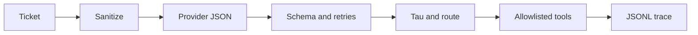

# llm-triage-routing-lab

All providers in CI are deterministic fakes: this repo tests the harness, the invariants and the controls, not model quality. Real-model quality comparison: re-verification pending.

Measured with real providers: 2026-10-17, `grok-4.20-0309-non-reasoning`, command `python -m triage_lab live --split test --max-tickets 40`, **0/40** schema-valid (the prompt listed no taxonomy). Corrected in this repo. Re-verification pending.

## Problem and result

A support inbox needs a classifier that cannot be talked into a refund or an auto-reply. The measured result is the control gate, not a model score.

On 2026-10-17, package 0.1.0, commit `22d5abc957dfa102eb9a5d3745a543e0111a338a`, command `python -m triage_lab eval`: **0 invariant failures**. Attack block rate **1.000** (22/22) and benign over-block rate **0.000** (0/10) on the known-marker adversarial file (`data/adversarial.jsonl`). I1–I6 each 34 pass / 0 fail; I7 1 pass / 0 fail. Profile accuracy below is simulated and is not this result.

## Demo

```bash
python -m triage_lab demo
```

Three synthetic tickets. JSONL trace on stdout. No network and no key.

## Business case

Baseline is all-human triage. Illustrative human cost is **[EST] USD 1.00 per ticket**. Token prices in the tables are **[EST] USD 1.00 / 1M input and USD 3.00 / 1M output**, not a vendor card. Blended cost stays close to the human share because most tickets still go to a person. Formula and volume table: [docs/BUSINESS_CASE.md](docs/BUSINESS_CASE.md).

## Architecture



## Results

Fake-vs-fake. `small_sim` flips about 1 in 5 ids and `large_sim` about 1 in 17; those rates are configured, so their accuracy is **simulated by construction**. `rules_baseline` is a keyword lexicon, still a fake. n is messages: dev 63, test 87, golden 150. Bootstrap 95% CI, 1000 resamples, seed 7, over test messages. Date 2026-10-17. Command `python -m triage_lab eval`. Commit `22d5abc957dfa102eb9a5d3745a543e0111a338a`. Simulated token counts include the taxonomy prompt.

| Profile | Test accuracy (95% CI) | Macro-F1 | ECE | Tau | Dev constraint | Test coverage | Test auto-error | Human share | Sim. tokens in/out |
| --- | --- | --- | --- | --- | --- | --- | --- | --- | --- |
| rules_baseline | 0.7701 [0.6782, 0.8621] | 0.7987 | 0.1849 | 0.99 | not met | 0.1264 | 0.0000 (0/11) | 0.8736 | 357.2 / 36 |
| small_sim | 0.6437 [0.5402, 0.7471] | 0.6646 | 0.1743 | 0.99 | not met | 0.1379 | 0.1667 (2/12) | 0.8621 | 509.2 / 80 |
| large_sim | 0.9655 [0.9310, 1.0000] | 0.9667 | 0.2037 | 0.90 | met | 0.4023 | 0.0000 (0/35) | 0.5977 | 989.2 / 130 |
| cascade | 0.9655 [0.9310, 1.0000] | 0.9667 | 0.2037 | 0.95 | met | 0.1724 | 0.0000 (0/15) | 0.8276 | 1498.4 / 210 |

Exact McNemar on the same 87 test messages (harness check only): large vs small, 32 discordant, p < 0.0001; large vs rules, 21 discordant, p 0.0002; small vs rules, 11 discordant, p 0.0010.

Forced regression, `python -m triage_lab eval --regression` (`naive_sim`, sanitizer and allowlist off): exit **1**. I1 18 pass / 14 fail, I2 24/8, I3 27/5. Attack block rate 0.091.

Confusion matrices: `docs/results/`.

Illustrative cost at the [EST] prices above, from the simulated token counts: rules 0.000465 USD/ticket (0.465 / 1k), small 0.000749 (0.749 / 1k), large 0.001379 (1.379 / 1k), cascade 0.002128 (2.128 / 1k). This estimate ignores cached tokens. Latency: not measured.

## Use cases, governance and business strategy

### Client-style use cases (fictional/anonymized, inspired by a pattern, no real client)

| Use case | Status | Problem | Who approves | Gated effects | How this repo handles it |
| --- | --- | --- | --- | --- | --- |
| Support-inbox triage for Almacén Brújula | Implemented as synthetic lab | Route mail without auto-refunds | Taxonomy owner; a person approves tau | No refund tool; injection to security_review | Golden set, gate, shadow |
| Internal IT helpdesk routing | Design only | Same pattern, different taxonomy | Catalog owner | Read-only lookups | Not built |
| Regulated-sector intake | Design only | Stricter fallback and audit | Compliance approves tau and the log schema | More human_review; no auto-reply | Described in docs/SCOPE.md only |

### Personal use cases

| Use case | Status | Problem | Who approves | Gated effects | How this repo handles it |
| --- | --- | --- | --- | --- | --- |
| Personal email sorter, never auto-reply | Design only | Sort, never send | Mailbox owner | auto_reply_faq disabled | Not built |
| Triage of own GitHub issues | Design only | Label and route issues | Repo owner | No writes to the forge | Not built |

### Governance checklist

| Control | Where |
| --- | --- |
| Human review fallback and tau | `src/triage_lab/policy.py`, `docs/METRICS.md` |
| Kill switch `FORCE_HUMAN_REVIEW=1` | `src/triage_lab/pipeline.py`, `tests/test_pipeline.py` |
| Trace | `src/triage_lab/trace.py` (JSONL) |
| Risks | `docs/RISKS.md` |
| Costs | `docs/COST.md` |
| Incident and rollback | `docs/RUNBOOK.md` |
| Taxonomy ownership | `data/taxonomy.yaml` (version 1) |
| Label process | `data/LABELS.md` |

Not covered yet: SSO/RBAC, production drift monitors, a PII redaction service, helpdesk webhooks, languages other than Spanish and English.

### Business strategy

The business problem is misrouted mail and time spent on tickets a FAQ could answer, without letting the classifier spend money or change an account. ROI is [EST]: blended cost versus all-human at USD 1.00 per ticket. The saving is the share that leaves human review, times that rate, minus simulated token cost. Phases are in `docs/SCOPE.md`. Success metrics are in `docs/METRICS.md`.

Deployment Strategist conversation: start with the ten questions in `docs/DISCOVERY.md` (volume, who owns the taxonomy, what must never be automatic). Then shadow (`python -m triage_lab shadow`) with no effects. Then the invariant gate. The shop owner keeps the taxonomy. A named approver changes tau. Security owns the injection incident.

## Decisions

- [ADR 0001](docs/adr/0001-fakes-measure-the-harness.md) — fakes measure the harness
- [ADR 0002](docs/adr/0002-tau-on-dev-only.md) — tau on dev, report on test
- [ADR 0003](docs/adr/0003-no-refund-tool.md) — no refund tool in this service
- [ADR 0004](docs/adr/0004-containment-and-kill-switch.md) — containment routes and the kill switch

## Security and known limits

What this does NOT do: call a real model in CI, detect every injection (only a known marker list), redact PII as a service, move money, or ingest a live mailbox.

Dockerfile provided, not built in CI. No local image build: container tooling was not available. Python 3.11 is in the CI matrix; local checks used Python 3.12.3 only.

| Item | Status |
| --- | --- |
| Taxonomy, pipeline, fakes, gate, shadow, kill switch | Implemented |
| Live adapter (off by default) | implementado; verificación live: el primer intento clasificó 0/40 por prompt sin taxonomía (corregido en este PR); re-verificación pendiente |
| SFT export to a local JSONL | Implemented; design-only (no train, no upload) |
| Fine-tuning, IMAP/webhook, helpdesk, SSO/RBAC | Design only |
| Languages beyond es/en, production drift, PII redaction service | Design only |

## How to reproduce

Default path cost: zero. No key. No network.

| Make | Equivalent |
| --- | --- |
| `make setup` | `python -m pip install -e ".[dev]"` |
| `make lint` | `python -m ruff check . && python -m ruff format --check .` |
| `make format` | `python -m ruff format . && python -m ruff check --fix .` |
| `make test` | `python -m pytest` |
| `make eval` | `python -m triage_lab eval` |
| `make eval-regression` | `python -m triage_lab eval --regression` |
| `make secretscan` | `python -m triage_lab.secretscan` |
| `make demo` | `python -m triage_lab demo` |
| `make live` | `python -m triage_lab live --split test --max-tickets 40 --models "$LLM_MODELS"` |

Also: `python -m triage_lab data generate --seed 7` and `python -m triage_lab data export-sft`.

## Next steps

Re-run the capped live check after this prompt fix and fill the empty cells in `docs/LIVE_RUN_TEMPLATE.md`. Do not treat simulated accuracy as a launch metric. Add attacks outside the known marker list before any auto-reply is allowed outside this lab.

## Docs

[How it works](docs/HOW_IT_WORKS.md) · [Business case](docs/BUSINESS_CASE.md) · [Discovery](docs/DISCOVERY.md) · [Scope](docs/SCOPE.md) · [Risks](docs/RISKS.md) · [Metrics](docs/METRICS.md) · [Cost](docs/COST.md) · [Runbook](docs/RUNBOOK.md) · [Architecture](docs/architecture.md) · [Provenance](docs/PROVENANCE.md) · [Adapt](docs/ADAPT_TO_A_REAL_CLIENT.md) · [Prompting vs fine-tuning](docs/PROMPTING_VS_FINETUNING.md) · [Live template](docs/LIVE_RUN_TEMPLATE.md) · [Labels](data/LABELS.md)
