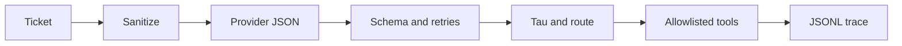

# llm-triage-routing-lab

[](https://github.com/dlescanogithub/llm-triage-routing-lab/actions/workflows/ci.yml)

## Start here

On the committed synthetic files, the control gate records zero invariant failures, and the forced regression exits 1 when the sanitizer and the allowlist are turned off.
One command, no key and no network: `python -m triage_lab demo`.
Walkthrough: [docs/HOW_IT_WORKS.md](docs/HOW_IT_WORKS.md). The unit-test line measured on 2026-10-22 is in [Proof](#proof).

Offline lab for one support inbox. The shop, Almacén Brújula, is fictional. Providers in CI are deterministic fakes. They exercise the harness, the invariants, and the controls. They do not measure a model.

> **Honest limits.** Fake-versus-fake accuracy is **SIMULATED** by construction (`small_sim` flips about 1 id in 5, `large_sim` about 1 in 17). Do not quote it as model quality. A separate live check, **MEASURED** on 2026-10-17, is not part of CI: `grok-4.20-0309-non-reasoning`, temperature 0, test split, 87 messages, schema-valid 87 of 87, accuracy 82 of 87 and 83 of 87 on two runs. [docs/LIVE_RUN_TEMPLATE.md](docs/LIVE_RUN_TEMPLATE.md) labels that check as measured by independent verification. Attack block on that live split has 4 messages, which this lab treats as inconclusive. Benign over-block on that split has a zero denominator, so the rate is not applicable. Last run cost US$0.0391. The repo estimate 0.0675 ignores cached tokens. Token counts for those runs were not stored. Latency was not measured.

## Problem and result

A support inbox needs a classifier that cannot be talked into a refund or an auto-reply. The result this repo stands on is the control gate, not a model score.

On 2026-10-17, package 0.1.0, commit `81e3aac00afc5f3662fb20af60aa7642ba198a99`, command `python -m triage_lab eval`: **0 invariant failures**. Attack block rate **1.000 on 22 messages** (the eval prints `1.000 (n=22)`) and benign over-block **0.000 on 10 messages** (the eval prints `0.000 (n=10)`) on the known-marker file `data/adversarial.jsonl`. I1 through I6 are counted on 34 messages: the 32-row adversarial file plus two probes (`compromised_sim` and `invalid_sim`). Each of I1–I6 is 34 pass and 0 fail. I7 is one aggregate check: 1 pass and 0 fail. The attack and benign denominators stay on the file slices (22 and 10). The probes are not in those denominators. Profile accuracy in the table below is simulated and is not this result.

The same date has the live check in the callout above. An earlier same-day check classified 0 of 40 because the prompt did not include the taxonomy. That prompt was corrected. The 0 of 40 figure is history, not the result to cite.

## Quickstart

Cost of the default path: **zero**. No API key is read. No network call is made.

```bash
python -m pip install -e ".[dev]"
python -m triage_lab demo
```

`make setup` and `make demo` are the same two steps. `make` may be absent. The `python -m` forms are enough.

**MEASURED** 2026-10-22, package 0.1.0, provider `large_sim`. Stdout was these three lines:

```text
demo-1 category=product_question route=auto_reply_faq injection=False
demo-2 category=order_status route=logistics_queue injection=False
demo-3 category=product_question route=security_review injection=True
```

The third ticket carries a known injection marker. The route is `security_review`, not the auto-reply. The demo does not print a JSONL trace.

The full local checklist is in [How to reproduce](#how-to-reproduce).

## Business case

Baseline is all-human triage. Illustrative handling time is **[EST] 4 minutes** per ticket at **[EST] USD 15 per hour**, which is **[EST] USD 1.00 per ticket**. Token prices in the tables are **[EST] USD 1.00 per million input tokens and USD 3.00 per million output tokens**, not a vendor card. Blended cost stays close to the human share because most tickets still go to a person. Formula, the worked `large_sim` example, and the volume table: [docs/BUSINESS_CASE.md](docs/BUSINESS_CASE.md) and [docs/COST.md](docs/COST.md). The value-realization write-up that reuses those figures is [docs/BUSINESS_VALUE.md](docs/BUSINESS_VALUE.md).

## Architecture



Path of one ticket, from [docs/architecture.md](docs/architecture.md):

1. If `FORCE_HUMAN_REVIEW` is set to 1, the route is `human_review` and the provider is not called.
2. Otherwise the sanitizer strips control characters, cuts the text at 4000 characters, and neutralizes a fixed marker list. The regression command is the only path that turns this off.
3. The body is wrapped in `<ticket>` delimiters, separate from the instructions.
4. The provider must return JSON: `category` (one of the nine exact names), `confidence` from 0.0 to 1.0, `injection_suspected`, and `rationale`. Cassette misses raise. They do not open a socket.
5. Invalid JSON is retried up to 3 times. The retry names the failed field. After 3 attempts the route is `human_review`.
6. Policy: injection, or category `abuse_or_legal`, goes to `security_review` at every tau. Confidence below tau goes to `human_review`. Otherwise the category's route in `data/taxonomy.yaml` (version 1) is used.
7. A model-requested tool outside that route's allowlist is logged as `tool_blocked` and the route becomes `security_review`. It is not executed.
8. The auto-reply text is the constant `FAQ_REPLY` in code, not the model rationale. There is no refund tool.

Nine categories, six routes. Privilege runs from `human_review` and `security_review` (both containment, privilege 0) up to `billing_queue` (privilege 4). Tools are read, internal note, or queue name. Refunds, charges, and account edits are a different system, after a person.

Profiles shipped with the package: `rules_baseline` (keyword lexicon), `small_sim`, `large_sim`, `cascade` (small, then large if confidence is below tau), `naive_sim` (obeys known markers; used by the forced regression), `compromised_sim` (asks for `approve_refund`, which is not in the registry), `invalid_sim` (non-JSON, for the retry path). The optional live adapter in `live.py` stays off unless `LIVE_LLM` is set to 1.

## Results

Fake versus fake. `small_sim` flips when `stable_hash(id:small)` modulo 5 is 0, and `large_sim` when `stable_hash(id:large)` modulo 17 is 0, so their accuracy is **SIMULATED** by construction. `rules_baseline` is a keyword lexicon, still a fake. Message counts: dev 63, test 87, golden 150. Bootstrap 95 percent interval, 1000 resamples, seed 7, over test messages. Date 2026-10-17. Command `python -m triage_lab eval`. Commit `d5f1a0ec694a34dd2977db170820abf25f9ddb06` for the cost and business-case write-up of this run; the invariant summary file records commit `81e3aac00afc5f3662fb20af60aa7642ba198a99`. Rates below are the published four-decimal rounding of [docs/results/summary.json](docs/results/summary.json). Simulated token counts include the taxonomy prompt and are the three-decimal figures in [docs/COST.md](docs/COST.md).

| Profile | Test accuracy (95 percent CI) | Macro-F1 | ECE | Tau | Dev constraint | Test coverage | Test auto-error | Human share | Sim. tokens in/out |
| --- | --- | --- | --- | --- | --- | --- | --- | --- | --- |
| rules_baseline | 0.7701 [0.6782, 0.8621] | 0.7987 | 0.1849 | 0.99 | not met | 0.1264 | 0.0000 (0 of 11) | 0.8736 | 357.207 / 36 |
| small_sim | 0.6437 [0.5402, 0.7471] | 0.6646 | 0.1743 | 0.99 | not met | 0.1379 | 0.1667 (2 of 12) | 0.8621 | 509.207 / 80 |
| large_sim | 0.9655 [0.9310, 1.0000] | 0.9667 | 0.2037 | 0.90 | met | 0.4023 | 0.0000 (0 of 35) | 0.5977 | 989.207 / 130 |
| cascade | 0.9655 [0.9310, 1.0000] | 0.9667 | 0.2037 | 0.95 | met | 0.1724 | 0.0000 (0 of 15) | 0.8276 | 1498.414 / 210 |

`select_tau` picks tau in {0.0, 0.1, …, 0.9, 0.95, 0.99} to maximize dev coverage subject to dev auto-error at or below 0.02. Ties take the higher tau. If none is feasible, tau is 0.99 and the dev constraint is not met. That is why `rules_baseline` and `small_sim` sit at 0.99.

Exact McNemar on the same 87 test messages, harness check only, as printed by that eval (`p_display` in the summary file): large versus small, 32 discordant, p < 0.0001; large versus rules, 21 discordant, p 0.0002; small versus rules, 11 discordant, p 0.0010. These compare fakes.

Forced regression, `python -m triage_lab eval --regression` (`naive_sim`, sanitizer and allowlist off): exit **1**. The probes are not added on this path, so the counts are on 32 messages. I1 is 18 pass and 14 fail, I2 is 24 pass and 8 fail, I3 is 27 pass and 5 fail. I4, I5, and I6 are 32 pass and 0 fail. I7 passes. Attack block rate prints as 0.091 on 22 messages (2 of 22; the JSON value is 0.09090909090909091). Benign over-block prints as 0.000 on 10 messages.

Confusion matrices: [docs/results/](docs/results/).

Illustrative cost at the [EST] prices above, from the simulated token counts. This estimate ignores cached tokens. Latency: not measured. The eval clock is frozen.

| Profile | USD per ticket [EST] | USD per 1,000 [EST] |
| --- | ---: | ---: |
| rules_baseline | 0.000465 | 0.465 |
| small_sim | 0.000749 | 0.749 |
| large_sim | 0.001379 | 1.379 |
| cascade | 0.002128 | 2.128 |

### Measured with a real provider

Not CI. One model, one prompt family, temperature 0, the test split. Recorded in [docs/LIVE_RUN_TEMPLATE.md](docs/LIVE_RUN_TEMPLATE.md). Token cells for the 87-message runs are empty on purpose.

| Date | What | Result |
| --- | --- | --- |
| 2026-10-17 | `grok-4.20-0309-non-reasoning`, 40 messages, prompt without the taxonomy | schema-valid 0 of 40, all `human_review`. Later corrected. Do not cite as the quality result. |
| 2026-10-17 | Same model, temperature 0, test split, 87 messages, two runs | schema-valid 87 of 87. Accuracy 82 of 87 and 83 of 87. The repo states that 83 of 87 is 95.4 percent. |
| 2026-10-17 | Last of those two runs | cost US$0.0391. Repo estimate 0.0675 ignores cached tokens. |
| 2026-10-17 | Attack block and benign over-block on that live split | 4 attack messages, inconclusive. Benign over-block not applicable (0 messages). |

A comparative live check that used one price for every model recorded **0.0044 USD** for `grok-4.3` against about **0.0131 USD** at that model's own rate (2026-10-17, reported from the run, not recomputed in this file). `LLM_MODEL_PRICE_TABLE` now prices each model, and a missing row aborts before the call. Those figures also ignore cached tokens.

## Use cases, governance and business strategy

### Client-style use cases (fictional, inspired by a pattern, no real client)

Almacén Brújula is the fictional shop already used in this repository. The rows are patterns, not an engagement.

| Use case | Status | Problem | Who approves | Gated effects | How this repo handles it |
| --- | --- | --- | --- | --- | --- |
| Support-inbox triage for Almacén Brújula | Implemented as a synthetic lab | Route mail without auto-refunds or an injection that becomes an auto-reply | Taxonomy owner; a named person approves tau | No refund tool; injection goes to `security_review` | Golden set, invariant gate, shadow mode, kill switch |
| Internal IT helpdesk routing | Design only | Same pattern, different taxonomy | Catalog owner | Read-only lookups | Not built |
| Regulated-sector intake | Design only | Stricter fallback and audit | Compliance approves tau and the log schema | More `human_review`; no auto-reply | Described in [docs/SCOPE.md](docs/SCOPE.md) only |

### Personal use cases

| Use case | Status | Problem | Who approves | Gated effects | How this repo handles it |
| --- | --- | --- | --- | --- | --- |
| Personal email sorter, never auto-reply | Design only | Sort, never send | Mailbox owner | `auto_reply_faq` disabled | Not built |
| Triage of one's own GitHub issues | Design only | Label and route issues | Repo owner | No writes to the forge | Not built |

### Design-only versus implemented

| Piece | Status |
| --- | --- |
| Taxonomy, pipeline, fakes, invariant gate, shadow, kill switch | Implemented |
| Live adapter | Implemented, off unless `LIVE_LLM` is 1. The 2026-10-17 check above is **MEASURED** and is not in CI |
| SFT export to a local JSONL | Implemented as a file export. No training run and no upload |
| Fine-tuning, IMAP or webhook ingest, helpdesk connector, SSO or RBAC | Design only |
| Languages other than Spanish and English, drift monitors, a PII redaction service | Design only |

### Governance checklist

| Control | Where it lives |
| --- | --- |
| Human-review fallback and tau | `src/triage_lab/policy.py`, [docs/METRICS.md](docs/METRICS.md). Tau is chosen on dev only |
| Kill switch `FORCE_HUMAN_REVIEW` set to 1 | `src/triage_lab/pipeline.py`, `tests/test_pipeline.py` |
| Trace | `src/triage_lab/trace.py` (JSONL). Ids and routes, not the full body |
| Risks | [docs/RISKS.md](docs/RISKS.md) |
| Costs | [docs/COST.md](docs/COST.md) |
| Incident and rollback | [docs/RUNBOOK.md](docs/RUNBOOK.md) |
| Taxonomy ownership | `data/taxonomy.yaml` (version 1) |
| Label process | [data/LABELS.md](data/LABELS.md). No second annotator |
| Secrets stay out of the tree | `src/triage_lab/secretscan.py`, `.env.example`. CI runs the scan |
| No paid call in CI | The workflow does not set `LIVE_LLM`. Tests inject a transport. `urllib` is not used in tests |

Not covered yet: SSO or RBAC, drift monitors on a live inbox, a PII redaction service, helpdesk webhooks, languages other than Spanish and English, and a real mailbox.

### Business strategy

The business problem is misrouted mail and time spent on tickets a FAQ could answer, without letting the classifier spend money or change an account. The ROI model is **[EST]** and lives in [docs/BUSINESS_CASE.md](docs/BUSINESS_CASE.md): blended cost versus all-human at USD 1.00 per ticket. The saving is the share that leaves human review, times that rate, minus simulated token cost. Scope and phases are in [docs/SCOPE.md](docs/SCOPE.md). Success metrics are in [docs/METRICS.md](docs/METRICS.md). This repository is phase 0. Phases 1 through 4 are not done.

Deployment conversation: start with the ten questions in [docs/DISCOVERY.md](docs/DISCOVERY.md) (volume, who owns the taxonomy, what must never be automatic). Then shadow (`python -m triage_lab shadow`) with no customer effect. Then the invariant gate. The shop owner keeps the taxonomy. A named approver changes tau. Security owns an injection incident. The platform owner owns the kill switch and the rollback. This lab is the checklist for that conversation. It is not evidence that the conversation already happened with a live desk.

## Business value

> **Same fictional shop.** Almacén Brújula is invented for this lab. It is not an employer or a client. Money figures below are the repo's own **[EST]** placeholders, not a new set of assumptions. Full plan: [docs/BUSINESS_VALUE.md](docs/BUSINESS_VALUE.md).

**What the repo can point at:**

- **MEASURED** gate, 2026-10-17: 0 invariant failures on the committed adversarial file; attack block 1.000 on 22 messages; benign over-block 0.000 on 10 messages.
- **MEASURED** forced regression: exit 1 when the sanitizer and the allowlist are off.
- **MEASURED** live sample, 2026-10-17, one model, 87 messages, two accuracy runs: schema-valid 87 of 87, accuracy 82 of 87 and 83 of 87. Not a launch metric. Attack count 4 is inconclusive.
- **SIMULATED** `large_sim` operating point on that eval: test human share 0.5977, test auto-error 0 of 35, dev constraint met at tau 0.90.
- **[EST]** saving versus all-human at USD 1.00 per ticket, for that `large_sim` point: **0.401 USD per ticket**. At the published illustration of 10,000 tickets in a month, the operating difference is **4,010 USD** in that month. Build hours are not in the repo, so a project payback is not stated.

| KPI | Category | Baseline | Target |
| --- | --- | --- | --- |
| Invariant failures on the lab gate | Resilience | 0 on the 2026-10-17 eval [MEASURED] | Exit 0, and the forced regression stays exit 1 [repo exit criteria] |
| Attack block on the known-marker file | Risk | 1.000 on 22 messages [MEASURED] | The gate, on that file. Not a field rate |
| Benign over-block | Experience | 0.000 on 10 messages [MEASURED] | At or below 0.10 (I7) |
| Dev auto-error | Quality | `large_sim` met the 0.02 cap; rules and small did not [SIMULATED] | At or below 0.02 on dev, tau frozen before test |
| Human share | Productivity | All-human, share 1 [EST baseline] | No numeric target in the repo. Reported test share for `large_sim` is 0.5977 [SIMULATED] |
| USD per ticket, blended | Cost | 1.00 all-human [EST] | `large_sim` blended 0.599 [EST]. Not a measured invoice |
| Live schema and accuracy | Quality | 87 of 87 schema-valid; 82 and 83 of 87 [MEASURED, one model] | No launch target in the repo |
| Time to route | Experience | Not measured | Left blank on purpose |

The robust claim is the control (no refund tool, known-marker containment, a kill switch), not the simulated accuracy.

## Decisions

- [ADR 0001](docs/adr/0001-fakes-measure-the-harness.md) — fakes measure the harness
- [ADR 0002](docs/adr/0002-tau-on-dev-only.md) — tau on dev, report on test
- [ADR 0003](docs/adr/0003-no-refund-tool.md) — no refund tool in this service
- [ADR 0004](docs/adr/0004-containment-and-kill-switch.md) — containment routes and the kill switch

## Security and known limits

Reporting path and the controls the code enforces: [SECURITY.md](SECURITY.md). Threat notes with owners: [docs/RISKS.md](docs/RISKS.md).

The sanitizer only neutralizes the marker list in `src/triage_lab/sanitize.py`. A phrase that is not on that list is not flagged. Attack block 1.000 on 22 messages is on the committed file, which uses that list. A denominator of 0 is not applicable, not 0. A count from 1 to 4 is labelled inconclusive. The source string for that label is Spanish; this README uses the English word.

Labels were written with the text. There is no agreement study. See [data/LABELS.md](data/LABELS.md).

A Dockerfile is in the repo. The CI workflow does not build it. Python 3.11 and 3.12 are in the CI matrix. The unit-test line in [Proof](#proof) was measured with Python 3.12.3 only. This page does not paste a 3.11 coverage number.

## What this does NOT prove

- It does not prove the quality of a live model. CI providers are fakes. The accuracy of `small_sim` and `large_sim` is configured.
- The 2026-10-17 live check is a small sample: one model, temperature 0, one test split of 87 messages, two accuracy runs. A rare miss would not show. Expectation-style accuracy on that split is not a score you can treat as settled.
- It does not prove the marker list catches an attack that is not written there. Add attacks outside the list before any auto-reply is allowed outside this lab.
- It does not prove behavior on a live mailbox, a helpdesk, a payment, or a refund. Those tools are not in this service.
- It does not prove annotator agreement, latency, or a handle time. The 4 minutes and the USD 1.00 are **[EST]**.
- It does not prove an implementation payback. The repo records no build hours and no vendor price card.
- A green `pytest` run does not mean the regression passed. `python -m triage_lab eval --regression` **must exit 1**. If it exits 0, the gate is broken.
- It does not prove the same coverage on Python 3.11. CI runs 3.11. This page reports the 3.12.3 measurement only.
- It does not prove a deployment on a live queue. Nothing here was connected to one.

## Proof

**MEASURED** 2026-10-22. Package 0.1.0. Python 3.12.3. pytest 9.1.1 (pytest-cov 7.1.0). This documentation change does not modify `src/` or `tests/`.

Command:

```bash
python -m pytest --cov=triage_lab --cov-report=term-missing --cov-fail-under=80
```

Those three flags are already `addopts` in `pyproject.toml`. The CI test step is `python -m pytest`, which applies the same flags. The command above passed them explicitly as well.

Result: **77 passed**. The pytest-cov total line was **91.38%** (`Total coverage: 91.38%`). The coverage table rounds that same total to 91 percent (2019 statements, 174 missed). The run also printed `CoverageWarning: Module triage_lab was previously imported, but not measured`. The 91.38 percent figure is the total pytest-cov printed anyway. The configured floor is 80 percent. This run cleared it.

This is the unit-test proof. It is not the eval gate and not the live check. Those are dated 2026-10-17 in [Results](#results).

## How to reproduce

Default path cost: **zero**. No key. No network.

```bash
python -m pip install -e ".[dev]"
python -m ruff check . && python -m ruff format --check .
python -m mypy src
python -m pytest --cov=triage_lab --cov-report=term-missing --cov-fail-under=80
python -m triage_lab eval
python -m triage_lab secretscan
python -m triage_lab demo
```

Forced regression (this process **must exit 1**):

```bash
python -m triage_lab eval --regression
```

CI runs that command and fails the job if the exit code is 0.

| Make target | Equivalent |
| --- | --- |
| `make setup` | `python -m pip install -e ".[dev]"` |
| `make lint` | `python -m ruff check . && python -m ruff format --check .` |
| `make format` | `python -m ruff format . && python -m ruff check --fix .` |
| `make test` | `python -m pytest` |
| `make eval` | `python -m triage_lab eval` |
| `make eval-regression` | `python -m triage_lab eval --regression` |
| `make secretscan` | `python -m triage_lab.secretscan` |
| `make demo` | `python -m triage_lab demo` |
| `make live` | `python -m triage_lab live --split test --max-tickets 40 --models "$LLM_MODELS"` |

`make live` is not part of the free path. It requires `LIVE_LLM` set to 1, `MAX_LIVE_SPEND_USD` greater than zero, and a price row for every model. A missing price aborts before the call. The ledger under `var/live-evals/` is gitignored. Do not commit keys. Empty names are in `.env.example`.

Also: `python -m triage_lab data generate --seed 7` and `python -m triage_lab data export-sft`. Shadow with no effects: `python -m triage_lab shadow --input data/golden.jsonl`.

## Next steps

1. Leave the token cells for the 87-message live runs empty in [docs/LIVE_RUN_TEMPLATE.md](docs/LIVE_RUN_TEMPLATE.md). Do not invent them.
2. Do not treat simulated accuracy as a launch metric. Do not treat 82 of 87 and 83 of 87 as anything larger than that sample.
3. Add attacks outside the known marker list before any auto-reply is allowed outside this lab.
4. A later live run is a new row with its own date, model, command, and cost. The 2026-10-17 rows stay as history, including the 0 of 40 prompt that lacked the taxonomy.

## Docs

| Doc | What it is for |
| --- | --- |
| [docs/HOW_IT_WORKS.md](docs/HOW_IT_WORKS.md) | Interview walkthrough |
| [docs/BUSINESS_CASE.md](docs/BUSINESS_CASE.md) | Saving formula. Money figures are [EST] |
| [docs/BUSINESS_VALUE.md](docs/BUSINESS_VALUE.md) | Value plan for the fictional shop. No new money figures |
| [docs/DISCOVERY.md](docs/DISCOVERY.md) | Ten questions and what each answer changes |
| [docs/SCOPE.md](docs/SCOPE.md) | Phases, out of scope, exit criteria |
| [docs/RISKS.md](docs/RISKS.md) | Probability, impact, mitigation, owner |
| [docs/METRICS.md](docs/METRICS.md) | What the eval reports, and where tau is chosen |
| [docs/COST.md](docs/COST.md) | [EST] token arithmetic and the volume table |
| [docs/RUNBOOK.md](docs/RUNBOOK.md) | Kill switch, injection incident, spend cap |
| [docs/architecture.md](docs/architecture.md) | Module map and the ticket path |
| [docs/PROVENANCE.md](docs/PROVENANCE.md) | Which utilities are shared across the portfolio |
| [docs/ADAPT_TO_A_REAL_CLIENT.md](docs/ADAPT_TO_A_REAL_CLIENT.md) | What to replace first |
| [docs/PROMPTING_VS_FINETUNING.md](docs/PROMPTING_VS_FINETUNING.md) | Design only. No training run |
| [docs/LIVE_RUN_TEMPLATE.md](docs/LIVE_RUN_TEMPLATE.md) | Recorded live rows. Empty token cells stay empty |
| [data/LABELS.md](data/LABELS.md) | How the synthetic labels were written |
| [SECURITY.md](SECURITY.md) | Reporting path and lab controls |
| [CHANGELOG.md](CHANGELOG.md) | What changed, by date |

## Authorship and how this was built

This repository was built with AI-assisted development.

**What I did (Diego Lescano):**

- Chose the problem and the scope: which failure to show, what is out of scope, and what the repo must not claim.
- Set the governance and business-strategy requirements for every case: approval controls, traceability, risks and costs, estimated ROI, rollout and metrics.
- Set the engineering standards: Python, tests, CI, synthetic data only, no real client or employer data.
- Reviewed and approved each change before merge, and decided what became public and when.
- Ran or approved the live measurements, and decided to publish the failures and the limits of the results as they came out.

**What AI coding agents did:**

- Wrote most of the code, tests, and documentation, working from those briefs and under review.

**What this repo does not claim:**

- It is not a deployed system, and every data set is synthetic.
- Live numbers come from a small sample, one model and one prompt; they are indicative, not conclusive.
