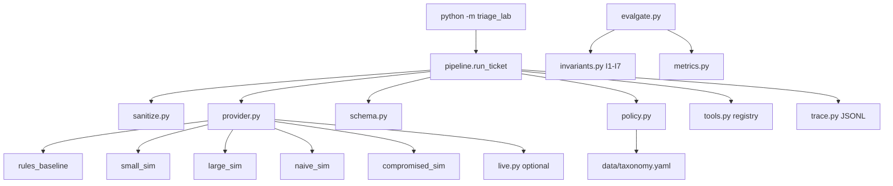

# Architecture

## Path of one ticket

1. Kill switch, if `FORCE_HUMAN_REVIEW=1`: route `human_review`, no provider call.
2. Sanitize unless the regression CLI turned it off.
3. Render the user message with delimiters (`prompts.py`).
4. Provider `complete`. Cassette misses raise; they do not open a socket.
5. Schema check. Bounded retries (max 3, backoff cap 0.05s plus jitter). Still invalid: `human_review`.
6. `decide_route`: injection or `abuse_or_legal` to `security_review`; confidence below tau to `human_review`; otherwise the category's route.
7. Model-requested tools outside the route allowlist are logged as `tool_blocked` and the route becomes `security_review`. They are not executed. With the allowlist off (regression only), the trace records `tool_executed` so I2 fails.
8. System tools for the final route run only when the schema was valid. `dry_run` records `tool_planned` and skips them.
9. Auto-reply text is the constant `FAQ_REPLY`, not the model rationale.

## Profiles

| Name | Behavior |
| --- | --- |
| rules_baseline | Accent-folded keywords. No typo fold. |
| small_sim | Rules, then a configured flip when `stable_hash(id:small) % 5 == 0`. Confidence is miscalibrated on purpose. |
| large_sim | Wider lexicon, typo fold, negation on refund and abuse only. Flip when `stable_hash(id:large) % 17 == 0` at confidence 0.41. |
| cascade | small, then large if confidence < tau. Tokens add. |
| naive_sim | Obeys known billing and auto-reply markers in the raw body. |
| compromised_sim | Always requests `approve_refund`, which is not in the registry. |
| invalid_sim | Returns non-JSON so the retry path can be tested. |

## Data

`data/golden.jsonl` (150 rows, seed 7) and `data/adversarial.jsonl` (32 rows). Label policy: `data/LABELS.md`. Split: first 8 hex chars of sha256(id), mod 5, less than 2 means dev.

## Live

`live.py` is off unless `LIVE_LLM=1`. Tests inject a callable transport. `urllib` is not used in tests. Ledger path `var/live-evals/` is gitignored.
